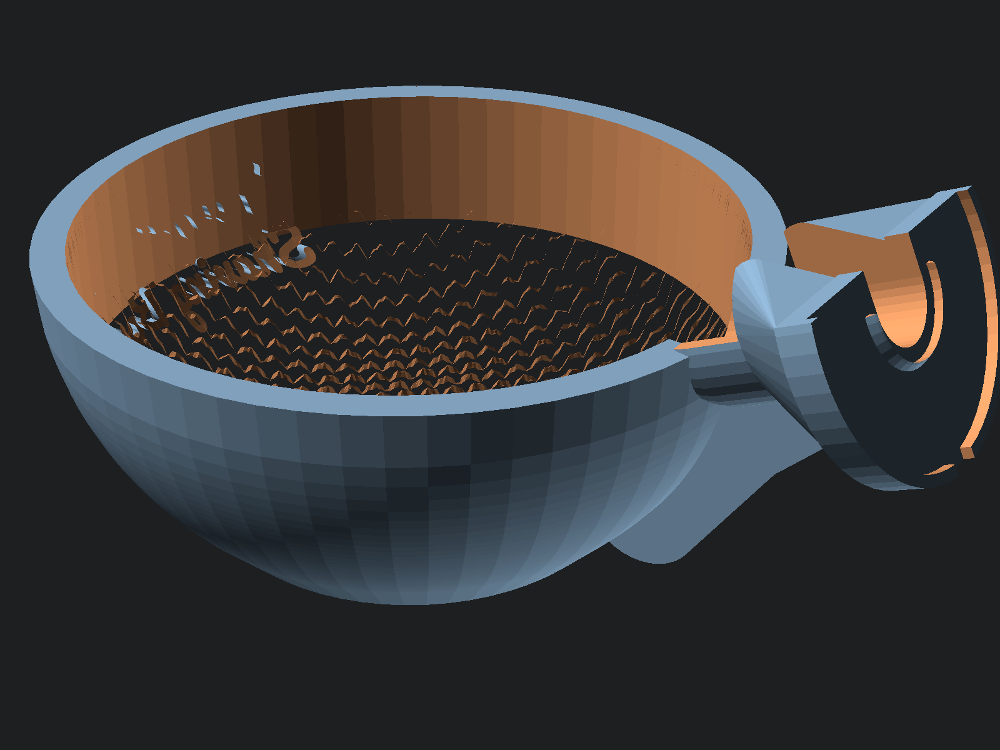

# Tumesh's Shaving Bowl (v14.2)

Parametric, open lather shaving bowl with a blended height-field lather surface, support-free ergonomic sliced cylinder handle, integrated safety razor cradle, and an interactive 3D Web Customizer. **Engineered specifically for support-free 3D printing on the Bambu Lab A1 Mini (0.40 mm nozzle, gold textured PEI plate).**



---

## What's New in v14.2 (Sliced Cylinder Ergonomics & Web App Overhaul)

1. **Sliced Cylinder Ergonomic Handle Support:**
   - **Flaw in v14.1:** The v14.1 lower strut was a flat 20 mm wide rectangular bar that felt boxy and slippery when lifted between two fingers with wet, soapy hands.
   - **v14.2 Solution:** Replaced with an architectural sliced-cylinder strut. The outer surface follows a smooth cylindrical arc, while the middle section tapers to an ergonomic **two-finger pinch waist** (narrowing to 15.6 mm at the midpoint).
   - **100% Support-Free:** Sloped along the $49^\circ$ self-supporting axis ($0.00\text{ mm}^2$ steep overhang $>45^\circ$) with zero inner cavity protrusion.
2. **Web App 3D STLLoader Integration:**
   - Integrated Three.js `STLLoader` into `index.html` and `app.js` to render the verified production binary STL directly in 3D.
   - Cures all disconnected floating boxes and reveals the authentic micro-diamond lather friction floor.
3. **Real-Time Dynamic Outer Wall Engraving:**
   - Promoted custom text inputs to a dedicated, always-visible card.
   - Dynamic 2D canvas decal renders the cursive `Pacifico` script text onto the 3D bowl wall live as you type.

---

## What's New in v14.1 (Support-Free & Manifold Turbo)

1. **100% Support-Free Handle Architecture:**
   - **Flaw Identified in v14:** The v14 lower return arch spanned 35 mm nearly horizontally ($\Delta Z = 2\text{ mm}$ over $\Delta X = 35\text{ mm}$, slope $\approx 3.3^\circ$), creating an unsupported **$700\text{ mm}^2$ flat ceiling hanging in mid-air at $Z = 12.6\text{ mm}$**, which drooped or failed without manual tree supports.
   - **v14.1 Solution:** Redesigned into a continuous $49^\circ$ self-supporting angled ergonomic truss that anchors solidly inside the bowl wall at $Z = 16\text{ mm}$ and rises at $\ge 49^\circ$ directly to the grip and cradle.
   - **Result:** Steep overhang area reduced from $>700\text{ mm}^2$ to **$0.00\text{ mm}^2$** on the lower handle. Completely eliminates the need for handle support structures while maintaining an open, quick-drying clearance ($Z = 0$ to $16\text{ mm}$) underneath.
2. **Support-Free Cradle Head Rest Transition:**
   - Extended the lower support plate transition cone along the cradle tube at $48^\circ$–$50^\circ$, reducing shelf underside overhang area by $>75\%$ for support-free head rest printing.
3. **Bulletproof Manifold Geometry Engine Fix:**
   - Added a coplanar-clearing cylinder cutout at the rim opening (`translate([0,0,bowl_height-0.5]) cylinder(h=5, r=inner_radius)`).
   - Completely cures OpenSCAD nightly's Manifold bug where co-planar boundary subtractions left a solid disk across the bowl opening.
   - Restores lightning-fast **15–20 second full mesh exports via `--backend=manifold`** (vs 6–7 minutes under CGAL).
4. **Separate Clean Codebase:**
   - Maintained as `travel_shaving_bowl_v14_1.scad` alongside original `travel_shaving_bowl.scad`.

---

## What's New in v14

1. **Renamed to "Tumesh's Shaving Bowl":**
   - Outer wall embossed lettering updated to `"Tumesh's"` on Line 1 and `"Shaving Bowl"` on Line 2 in Pacifico bold relief.
2. **Excised Base Inverted Triangle:**
   - Removed the solid downward-tapering triangular bed anchor, leaving open clearance underneath the handle for water drainage and drying.
3. **Parametric `blade_storage_enabled = false` (Default):**
   - Eliminates captive drawer moisture entrapment and DE blade corrosion.
4. **FDM Slicer Physics Optimization:**
   - `export_texture_resolution = 0.50` (matched to 0.40 mm nozzle / 0.42 mm extrusion width, cutting 60% of unnecessary micro-facets).
   - `terrain_preview_fn = 64` and `rounded_fn = 20`.
5. **Interactive 3D Web Customizer:**
   - Launch [`index.html`](index.html) in any browser (or via GitHub Pages) to customize dimensions, lather ridges, razor dock angles, and export custom binary STLs directly client-side.

---

## 3D Web Customizer App

Open [`index.html`](index.html) locally in your browser or host it via GitHub Pages:
- **Real-Time Three.js Viewport:** Orbit, pan, zoom, inspect wireframe, and test filament colors (Gold PEI, Charcoal Black, Arctic White, Ocean Blue).
- **Live Parametric Controls:** Bowl diameter, height, wall thickness, lather diamond friction scale, razor handle diameter clearance, and custom emboss text.
- **Client-Side Binary STL Export:** Generate slicer-ready binary STLs instantly from the browser without needing OpenSCAD installed.
- **OpenSCAD Exporter:** Live generates the exact `.scad` code matching customized parameters.

---

## Variants: Standard vs Travel

Selectable via `bowl_preset` in `travel_shaving_bowl.scad`:

| Specification | Travel (`bowl_preset = "travel"`) | Standard (`bowl_preset = "standard"`) |
| :--- | :--- | :--- |
| **Outer / Inner Diameter** | 84 / 73.7 mm | 110 / 100 mm |
| **Cavity Volume** | ~104 mL | ~241 mL |
| **Flat Swirl Floor (slope < 30°)** | 46 mm | 64 mm (fits 24–28 mm brush knots) |
| **Overall Size (L × W × H)** | 120 × 84 × 62 mm | 146 × 110 × 70 mm |
| **Wall Thickness** | ~5.1 mm | ~5.2 mm |
| **Swirl Surface Relief** | ~1.6 mm | 1.89 mm |
| **Bed Fit (A1 Mini 180×180 mm)** | +60 mm plate margin | +34 mm plate margin |
| **Official v14 STL** | `Tumeshs_Shaving_Bowl_v14_TRAVEL_norack_bin.stl` | `Tumeshs_Shaving_Bowl_v14_STANDARD_norack_bin.stl` |
| **Official v14.1 STL (Support-Free)** | `Tumeshs_Shaving_Bowl_v14_1_TRAVEL_bin.stl` | `Tumeshs_Shaving_Bowl_v14_1_STANDARD_bin.stl` |

---

## Bambu Studio / Slicer Recommendations

- **Printer:** Bambu Lab A1 Mini (or standard $180\times180\text{ mm}$ bed).
- **Plate:** WOL3D Gold Textured PEI.
- **Material:** PETG (recommended for hot water lather & bathroom humidity resistance) or PLA.
- **Profile:** 0.20 mm Standard.
- **Wall Loops:** 4 perimeters (ensures water-tight seal without post-processing).
- **Top / Bottom Shells:** 5 top, 4 bottom layers.
- **Infill:** 15% Gyroid.
- **Supports:** **Tree (Auto)**, `Threshold angle: 30°`, `Support critical regions only`.
  - The bowl body sits flat on the bed at $Z = 0.00\text{ mm}$. Tree supports only need to support the upper angled razor cradle overhang.

---

## Exporting via CLI

With OpenSCAD Nightly (Manifold backend):

```sh
# Standard preset (18 seconds):
openscad --backend=Manifold -D 'preview_mode=false' -D 'bowl_preset="standard"' -D 'blade_storage_enabled=false' -D 'part="bowl"' -o Travel_Shaving_Bowl_STANDARD_norack.stl travel_shaving_bowl.scad

# Travel preset:
openscad --backend=Manifold -D 'preview_mode=false' -D 'bowl_preset="travel"' -D 'blade_storage_enabled=false' -D 'part="bowl"' -o Travel_Shaving_Bowl_TRAVEL_norack.stl travel_shaving_bowl.scad
```

---

## License

This project is licensed under Creative Commons Attribution-NonCommercial-ShareAlike 4.0 International (CC BY-NC-SA 4.0). See LICENSE.

You may print it for yourself, share it and modify it, as long as you:
- give credit to Tumesh,
- do not sell it or its prints for money,
- share any modified version under the same licence.

For commercial use (selling prints or licensing the design), ask the author first.

The Pacifico font is under the SIL Open Font License and is not covered by this licence (see NOTICE.md).

